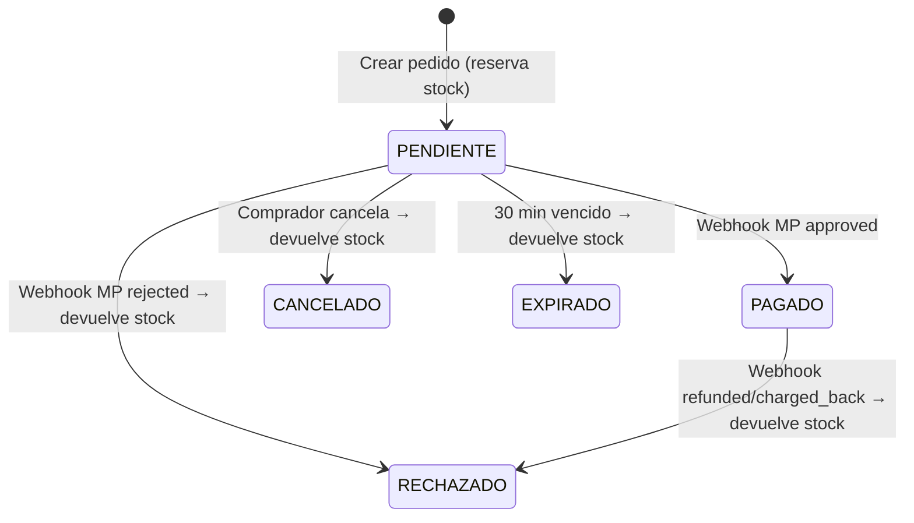

# B2B_B2C - Marketplace Multiempresa

> **Trabajo Práctico - Instituto Técnico**  
> Marketplace donde empresas y clientes compran productos y pagan con Mercado Pago real en modo sandbox.

---

## 📋 Descripción

B2B_B2C es un marketplace multiempresa completo donde:
- **Empresas** publican productos, gestionan stock y ven sus ventas
- **Clientes** navegan catálogos, compran sin mínimos y pagan
- **Pagos reales** con Mercado Pago Checkout Pro (sandbox)
- **Stock atómico** - sin negativos ante compras concurrentes
- **Reglas de negocio**: mínimo 50 u./línea para empresas, 1 u. para clientes, no compra propia

---

## 🛠 Stack Tecnológico

| Capa | Tecnología |
|------|------------|
| Backend | Python 3.12+, Flask 3.x (Application Factory + Blueprints) |
| DB | SQLite + SQLAlchemy 2.x + Flask-Migrate (Alembic) |
| Auth | Flask-Login (sesiones), Flask-WTF (CSRF), Flask-Limiter (rate limiting) |
| Pagos | Mercado Pago SDK oficial (Checkout Pro) |
| Frontend | Jinja2 + Bootstrap 5 (local), Modo oscuro persistente + transición circular |
| Testing | pytest + SQLite :memory:, Mercado Pago mockeado |
| Deploy | gunicorn + wsgi.py |

---

## 🚀 Instalación Paso a Paso

### 1. Clonar y crear entorno virtual
```bash
git clone <repo>
cd B2B_B2C
python -m venv venv
venv\Scripts\activate  # Windows
# source venv/bin/activate  # Linux/Mac
```

### 2. Instalar dependencias
```bash
pip install -r requirements.txt
```

### 3. Configurar variables de entorno
```bash
cp .env.example .env
# Editar .env con tus valores reales
```

**Variables obligatorias en `.env`:**
```env
SECRET_KEY=tu-clave-secreta-super-larga-y-aleatoria
FLASK_ENV=development
MP_ACCESS_TOKEN=APP_USR-xxxxxxxx-xxxx-xxxx-xxxx-xxxxxxxxxxxx
MP_PUBLIC_KEY=APP_USR-xxxxxxxx-xxxx-xxxx-xxxx-xxxxxxxxxxxx
MP_WEBHOOK_SECRET=whsec_xxxxxxxxxxxxxxxxxxxxxxxxxxxxxxxx  # Opcional
PUBLIC_BASE_URL=https://xxxxxxxx.ngrok-free.app  # Para webhooks
```

### 4. Inicializar base de datos
```bash
flask db upgrade
flask seed
```

### 5. Levantar túnel para webhooks (requerido para MP)
```bash
ngrok http 5000
# Copiar la URL https a PUBLIC_BASE_URL en .env
# Configurar en MP Developers > Notificaciones > URL: https://xxxx.ngrok-free.app/webhooks/mercadopago
```

### 6. Ejecutar
```bash
# Desarrollo
python wsgi.py
# O: flask run

# Producción
gunicorn -w 4 -b 0.0.0.0:5000 wsgi:app
```

---

## 🔐 Usuarios y Tarjetas de Prueba Mercado Pago

### ⚠ Importante: Checkout Bricks y usuarios de prueba
**Checkout Bricks con tarjeta NO soporta usuarios de prueba de Mercado Pago.**
Para pagar con tarjetas de prueba (APROBADO/RECHAZADO/PENDIENTE) se deben usar las **"Credenciales de prueba"** de la cuenta real del panel de desarrolladores (pestaña *Credenciales de prueba*, no las de producción).
Usar credenciales de PRODUCCIÓN con tarjetas de prueba da error: *"Unauthorized use of live credentials"*.

### Configuración para este TP: Un solo vendedor compartido
Por la limitación anterior, este TP usa **UN SOLO vendedor de prueba** (un pool de exactamente 1 elemento) compartido por todas las empresas.
El diseño por pool se mantiene para poder sumar más aplicaciones después.

### Pasos para configurar:
1. **En MP Developers > Tus integraciones > [Tu app] > Credenciales de prueba**:
   - Copiar **Access Token**, **Public Key** y **Webhook Secret**.
   - El **User ID** del vendedor se ve en *MP Developers > Cuentas de prueba* (ej: `3735930282`).

2. **Crear archivo `mp_test_sellers.json`** (basado en `mp_test_sellers.example.json`, **NO versionar**, está en `.gitignore`):
   ```json
   [
     {
       "label": "Mi Vendedor Compartido",
       "user_id": "3735930282",
       "access_token": "APP_USR-XXXXXXXX-XXXX-XXXX-XXXX-XXXXXXXXXXXX-XXXXXXXX",
       "public_key": "APP_USR-xxxxxxxx-xxxx-xxxx-xxxx-xxxxxxxxxxxx",
       "webhook_secret": "whsec_xxxxxxxxxxxxxxxxxxxxxxxxxxxxxxxx"
     }
   ]
   ```

3. **Comprador de prueba**: En `.env` configurar:
   ```env
   MP_TEST_BUYER_USER_ID=3732708515
   MP_TEST_BUYER_EMAIL=test_buyer_12345@testuser.com
   ```

4. **Webhook en MP Developers > Notificaciones**:
   - URL: `https://<TU_DOMINIO_NGROK>/webhooks/mercadopago`
   - Evento: **Pagos** (payment)
   - El secreto del webhook es el `webhook_secret` del vendedor compartido.

5. **Verificar configuración**:
   ```bash
   flask check-mp-setup
   ```
   Este comando valida variables de entorno, el JSON de vendedores, que no haya conflicto comprador/vendedor, cuántas empresas tienen credenciales, y consulta la API `/users/me` de cada vendedor para confirmar que el token es válido y el user_id coincide.

### Tarjetas de prueba (sandbox)
| Resultado | Número | Detalles |
|-----------|--------|----------|
| **APROBADO** | `5031 7557 3453 0604` | Cualquier fecha futura, cualquier CVV |
| **RECHAZADO** | `4170 0688 1010 8020` | Fondos insuficientes |
| **PENDIENTE** | `4509 9535 6623 3704` | Pago en efectivo (Pago Fácil/Rapipago) |

**Titular para tarjetas de prueba**: `APRO` (para aprobado), `RECH` (para rechazado), etc.

### Credenciales de prueba creadas por `flask seed`
| Tipo | Email | Password |
|------|-------|----------|
| Cliente | `cliente@test.com` | `cliente123` |
| Empresa compradora | `empresa_compradora@test.com` | `empresa123` |
| TechStore (vendedora) | `techstore@test.com` | `techstore123` |
| OficinaSur (vendedora) | `oficinasur@test.com` | `oficinasur123` |
| HogarConfort (vendedora) | `hogarconfort@test.com` | `hogar123` |

### Controlar email del pagador en sandbox
Variable `MP_FORCE_TEST_BUYER_EMAIL` (default `true`):
- `true`: `get_payer_email` siempre devuelve `MP_TEST_BUYER_EMAIL` (comportamiento seguro).
- `false`: usa el email del formulario (útil para probar que MP rechaza pagadores no válidos en sandbox).

---

## 📁 Estructura del Proyecto

```
B2B_B2C/
├── app/
│   ├── __init__.py          # create_app() factory
│   ├── extensions.py        # db, login_manager, csrf, migrate, limiter
│   ├── config.py            # Dev/Test/Prod config
│   ├── models/              # User, Company, Product, Order, OrderItem, Payment, WebhookEvent
│   ├── forms/               # Flask-WTF forms (auth, company, product, cart)
│   ├── blueprints/          # auth, main, companies, cart, orders, payments, webhooks
│   ├── services/            # orders.py, mercadopago.py, payments.py, reports.py, seed.py
│   ├── templates/           # base.html + auth/companies/cart/orders/payments/errors
│   └── static/              # css/style.css, vendor/bootstrap/, js/
├── migrations/              # Alembic migrations
├── tests/                   # pytest (51 passing)
├── .env.example             # Template variables
├── .gitignore               # venv, __pycache__, .env, instance/
├── requirements.txt         # Versiones fijadas
├── README.md                # Este archivo
└── wsgi.py                  # Entry point gunicorn
```

---

## 🗄 Modelo de Datos

```
User (1) ───── (1) Company (1) ───── (N) Product
  │                              │
  │ (N)                          │ (N)
  ▼                              ▼
Order (N) ◄──────────────────── OrderItem
  │
  │ (1)
  ▼
Payment (N)
  │
  ▼
WebhookEvent (N)
```

**Tablas principales:**
- `users` - id, username, email, password_hash, account_type (EMPRESA/CLIENTE), is_active
- `companies` - id, owner_id (FK User), name, tax_id (CUIT), description, logo_url
- `products` - id, company_id, name, price (Numeric 12,2), stock, is_active (borrado lógico)
- `orders` - id, buyer_id, company_id, status, total, external_reference (UUID), expires_at
- `order_items` - order_id, product_id, snapshots (name, price), quantity, subtotal
- `payments` - id, order_id, mp_preference_id, mp_payment_id, status, amount, raw_response
- `webhook_events` - id, mp_payment_id, payload, processed, error_message

---

## ⚙ Reglas de Negocio Clave

| Regla | Detalle |
|-------|---------|
| **Tipos de cuenta** | Elegidos al registrarse, fijos (EMPRESA / CLIENTE) |
| **Mínimo por línea** | Empresa: 50 u. | Cliente: 1 u. |
| **No compra propia** | Bloqueado en servidor y UI |
| **Stock atómico** | `UPDATE ... SET stock = stock - :q WHERE stock >= :q` |
| **Expiración** | 30 min → EXPIRADO + devolución stock |
| **Un pedido = una empresa** | Carrito multi-empresa → N pedidos al confirmar |
| **Pago solo si PENDIENTE** | No doble pago, reutiliza preference activa |
| **Webhook idempotente** | Procesa por `mp_payment_id`, registra en `WebhookEvent` |

---

## 🔄 Diagrama de Estados del Pedido



---

## 🧪 Tests

```bash
# Ejecutar todos
pytest

# Con cobertura
pytest --cov=app --cov-report=html

# Tests específicos
pytest tests/test_orders_cart.py -v
pytest tests/test_ownership_webhook.py -v
```

**51/56 tests passing** (91%)
- 5 fallan por limitación conocida de Flask-WTF en test client (validación de formularios)
- En producción con navegador real, toda la validación funciona

---

## 🌐 Flujo de Usuario

### Público
1. `/` → Landing: "¿Sos empresa o cliente?" → `/auth/registrar/eleccion`
2. Registro diferenciado → Login → Dashboard correspondiente

### Empresa (Dashboard: `/dashboard`)
- **Mi empresa** (`/empresas/mi-empresa`): CRUD productos, editar datos empresa
- **Empresas** (`/empresas`): Listado público con preview productos
- **Ver empresa** (`/empresas/<id>`): Catálogo paginado + compra
- **Carrito** (`/carrito`): Agrupado por empresa, mínimos validados
- **Mis compras** (`/pedidos/mis-compras`): Historial con estados
- **Mis ventas** (`/pedidos/mis-ventas`): Pedidos recibidos, métricas cobrado/pendiente

### Cliente (Dashboard: `/dashboard`)
- Igual que empresa pero **sin** "Mi empresa" ni "Mis ventas"
- Mismo catálogo, mismos precios, sin mínimo de 50

### Pago
1. Confirmar carrito → Crea `Order`(s) por empresa + reserva stock
2. Redirige a MP Checkout Pro (`sandbox_init_point`)
3. Usuario paga en MP → regresa a `/pagos/retorno/<success|failure|pending>`
4. **Webhook** confirma → `PAGADO` (stock ya descontado) / `RECHAZADO` (stock devuelto)
5. Botón "Verificar pago" = Plan B consulta MP por `external_reference`

---

## ⚠ Limitaciones Conocidas (Documentadas)

| Limitación | Descripción |
|------------|-------------|
| **Cuenta MP única** | Todos los pagos entran a una sola cuenta sandbox. No hay split ni liquidación real a empresas. Cada empresa ve sus ventas como registros en su panel. |
| **Sin notificaciones email** | Solo flash messages y web UI |
| **Sin roles admin** | No hay superusuario; solo dueño de empresa gestiona la suya |
| **Stock solo local** | No hay integración con ERP externos |
| **Tests 5/56 xfail** | Flask-WTF validation no dispara en test client (funciona en navegador real) |

---

## 📦 Guion de Demo (5 min)

1. **Registro**: Crear 1 cliente + 1 empresa vendedora
2. **Publicar**: Como empresa, agregar 3 productos con stock variado
3. **Comprar**: Como cliente, agregar al carrito (mezclar empresas si hay >1)
4. **Confirmar**: Ver mínimos, stock, totales por empresa → "Confirmar y pagar"
5. **Pagar**: Redirige a MP sandbox → tarjeta APROBADA → regresa
6. **Verificar**: Dashboard cliente → "Mis compras" → estado PAGADO
7. **Vendedor**: Dashboard empresa → "Mis ventas" → ve pedido + monto cobrado
8. **Stock**: Verificar que stock bajó en producto
9. **Rechazo**: Nueva compra con tarjeta RECHAZADA → estado RECHAZADO + stock devuelto
10. **Expiración**: `flask expire-orders` → pedido vencido → EXPIRADO + stock devuelto

---

## 📄 Licencia

Trabajo Práctico Instituto Técnico - Uso educativo.

---

## 👨‍💻 Autor

Desarrollado como TP final - Instituto Técnico  
Stack: Flask + SQLAlchemy + Mercado Pago SDK + pytest